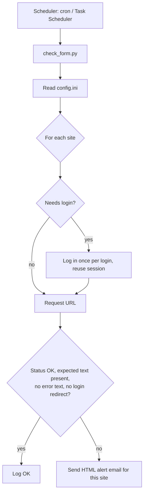

# Form Checker


A lightweight, config-driven monitor that checks whether your web pages and forms are **really** working, and emails you when they aren't.

Most uptime tools only check for an HTTP `200 OK`. That misses the failures that hurt most: a page that loads fine but shows an error message instead of the form, or a session that silently expired and bounced the request to a login screen. Form Checker looks at what is actually on the page.

## Features

- **Content verification:** confirms that a specific piece of text or HTML (a form field name, a button label, a heading) is present on the page.
- **Error-text detection:** optionally fails if a known error message appears on the page.
- **Status code check:** fails on any status other than the one you expect.
- **Login support:** logs in with a username and password before checking pages that sit behind authentication, including sites that use CSRF / anti-forgery tokens (common on ASP.NET).
- **Silent-failure detection:** flags a failure if a check ends up redirected back to a login page, even when that page returns `200`.
- **Multiple URLs:** monitor as many pages as you like from one config file, each with its own settings.
- **Separate logins per site:** each URL can use its own credentials, or share one login (the script logs in once per run and reuses the session).
- **Professional HTML alert emails:** one clear email per failing URL, with a plain-text fallback.
- **Quiet when healthy:** no email unless something is wrong.
- **Run log:** every check is written to `check_form.log`, including redirect chains, which makes debugging easy.
- **No code changes to add a URL:** everything lives in `config.ini`.

## How it works



## Quick start

### 1. Install

```bash
git clone https://github.com/mr-manojk/URL-Monitoring.git
cd form-checker
pip install -r requirements.txt
```

### 2. Configure

```bash
cp config.example.ini config.ini
```

Edit `config.ini`. It has one shared `[email]` section and one `[site:name]` section per URL:

```ini
[email]
smtp_host = smtp.gmail.com
smtp_port = 587
smtp_username = you@gmail.com
smtp_password = your_app_password
from_address = you@gmail.com
to_address = alerts@example.com

[site:contact_form]
site_name = Company Contact Form
url = https://example.com/contact
expected_status = 200
expected_text = name="contact-form"
forbidden_text = Something went wrong
timeout_seconds = 15
```

### 3. Run it

```bash
python check_form.py
```

Output goes to the console and to `check_form.log`. You only get an email when a check fails.

## Configuration reference

### `[site:name]`

| Option | Required | Description |
|---|---|---|
| `site_name` | no | Friendly name used in logs and alert emails. Defaults to the section name. |
| `url` | yes | The page to check. Wrap it in quotes if it ends in punctuation such as a comma. |
| `expected_status` | no | Expected HTTP status. Default `200`. |
| `expected_text` | no | Text/HTML that must appear on the page when it is healthy. |
| `forbidden_text` | no | Text that must **not** appear (for example, an error message). |
| `timeout_seconds` | no | Request timeout. Default `15`. |
| `login` | no | Name of a `[login:name]` section to use for this site. |

**Tip for choosing `expected_text`:** open the page, view the page source (Ctrl+U), and pick a short snippet that only exists when the real content is there, such as `id="submit-button"` or a unique heading.

### `[login:name]`

Only needed for pages behind a login. Reference it from a site with `login = name`.

```ini
[site:client_itinerary]
site_name = Client Itinerary
url = "https://example.com/itinerary/details/abc123,"
expected_text = Itinerary Details
login = client_login

[login:client_login]
login_url = https://example.com/Account/LogOn
username = your_username
password = your_password
username_field = UserName
password_field = Password
csrf_field = __RequestVerificationToken
```

| Option | Description |
|---|---|
| `login_url` | The page that hosts the login form. |
| `username`, `password` | Your credentials. |
| `username_field`, `password_field` | The `name="..."` attributes of the form's inputs (view page source to find them). Defaults: `UserName`, `Password`. |
| `csrf_field` | Name of the hidden anti-forgery field, if the form uses one. The script finds and submits it automatically. Default: `__RequestVerificationToken`. |

### `[email]`

Standard SMTP settings (STARTTLS). For Gmail, create an [App Password](https://myaccount.google.com/apppasswords) instead of using your normal password.

## Scheduling

### Linux / macOS (cron)

```bash
crontab -e
```

```
*/5 * * * * /usr/bin/python3 /path/to/form-checker/check_form.py >> /path/to/form-checker/cron.log 2>&1
```

### Windows (Task Scheduler)

Run in an elevated PowerShell (use the full path to `python.exe` from `where.exe python` if plain `python` is not found when scheduled):

```powershell
schtasks /create /tn "Form Checker" /tr "python C:\form-checker\check_form.py" /sc minute /mo 5 /st 00:00
```

If you prefer the GUI, create the task in Task Scheduler and set **Start in** to the folder containing the script, so it can find `config.ini`.

## Security notes

- `config.ini` contains passwords. It is listed in `.gitignore` so it is never committed. **Never commit your real config.** Only `config.example.ini` belongs in the repository.
- Use an app-specific password for email, not your main account password.
- Restrict file permissions on `config.ini` to your own user account.
- Only monitor sites you own or are authorised to access.

## Project structure

```
form-checker/
├── check_form.py          # The monitor
├── config.example.ini     # Template config (copy to config.ini)
├── requirements.txt       # Python dependencies
├── .gitignore             # Keeps secrets and logs out of git
└── README.md
```

## Troubleshooting

| Symptom | What to check |
|---|---|
| `Python was not found` on Windows | Use `python` instead of `python3`, and make sure Python was installed with "Add to PATH". |
| Check "passes" but you never see the real page | Set `expected_text`. Without it, a login page or error page that returns `200` looks healthy. |
| `Login POST still landed on a login page` | Wrong credentials, or `username_field` / `password_field` / `csrf_field` don't match the real form. |
| Trailing character seems missing from the URL | Wrap the URL in quotes. Also check `check_form.log`: redirects may percent-encode it (a trailing `,` becomes `%2c` inside a `ReturnUrl`). |
| No alert email arrives | Check `check_form.log` for `FAILED TO SEND EMAIL`, then verify SMTP host, port and app password. |

## Limitations and ideas

- Checks page content, but does not submit forms end to end.
- All sites share one schedule. Different frequencies would need a second scheduled task with its own config.
- Possible future work: digest emails, Slack / webhook alerts, form-submission tests, alert de-duplication so repeated failures don't resend every run.

## Contributing

Issues and pull requests are welcome. If you add a feature, please keep `config.example.ini` and this README in sync.
